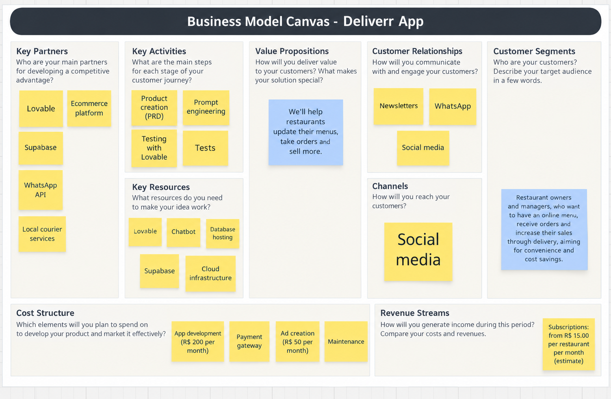
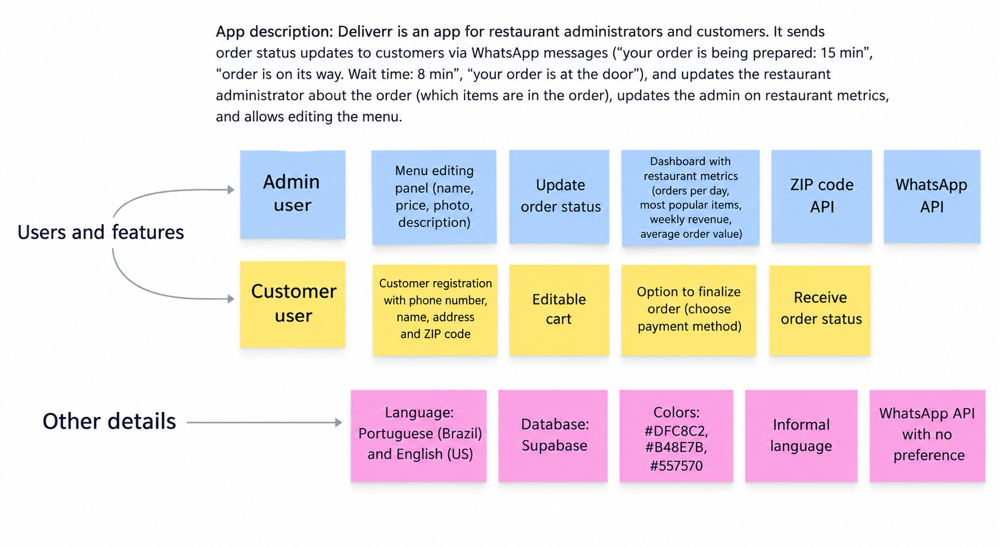

<div align="right">
  <a href="../README.md">Switch to Portuguese</a>
</div>

# Deliverrr : Vibe Coding for a Delivery App

## About the Project

**Deliverrr** is a delivery platform built using Vibe Coding principles, focused on providing a modern experience for both customers and restaurant owners.

The goal of the application is to centralize the entire delivery operation within a single platform, allowing restaurants to own their digital sales channel without relying exclusively on third-party marketplaces.

The project was designed with the following objectives:

- Automate the order management process.
- Organize orders through an intuitive Kanban workflow.
- Provide strategic business metrics for better decision-making.
- Enable automated customer communication through WhatsApp.
- Offer an intelligent virtual assistant called Elvisys for both customers and administrators.
- Provide a fully customizable digital menu.
- Support internationalization (PT-BR and EN-US).
- Deliver a modern, responsive, mobile-first experience.

---

## Core Features

- Elvisys (Primary Virtual Assistant)
- Digital Menu
- Shopping Cart
- Order Management
- Administrative Dashboard
- Operational Kanban Board
- WhatsApp Integration
- Customer Ratings and Feedback System
- Internationalization (i18n)
- Authentication and Access Control
- Automatic Delivery Fee Calculation
- Business Metrics and Reports

---

## Prompt Structure

| Prompt | Defined Feature | File Directory |
|----------|----------|----------|
| Prompt 1 | Elvisys (Chatbot, Authentication and Registration) | [Prompt 1](prompts_ENG-US/prompt1_chatbot.md) |
| Prompt 2 | Digital Menu | [Prompt 2](prompts_ENG-US/prompt2_menu.md) |
| Prompt 3 | Administrative Area (Dashboard, Kanban, Admin Elvisys and Feedback) |[Prompt 3](prompts_ENG-US/prompt3_area_adm.md) |
| Prompt 4 | WhatsApp Integration and Notifications | [Prompt 4](prompts_ENG-US/prompt4_whatsapp_api.md)  |
| Prompt 5 | Supabase Database Structure | [Prompt 5](prompts_ENG-US/prompt5_supabase.md)   |

---
## Initial Business Model Canvas e Brainstorm



---
## Overall

```text
Customer
   │
   ▼
Elvisys
   │
   ├── Sign In
   ├── Registration
   ├── Visitor
   └── Restaurant Owner
            │
            ▼
        Dashboard
            │
            ├── Kanban
            ├── Menu
            ├── WhatsApp
            ├── Feedback
            └── Admin Elvisys
```

---

## Elvisys

Elvisys is the official virtual assistant of Deliverrr.

Its responsibilities include:

- Entry point to the platform.
- Registration assistant.
- Login assistant.
- Administrative assistant.
- Alert center.
- Future operational co-pilot for restaurant management.

### Supported User Flows

#### Visitor

- Browse the menu.
- View prices.
- Build a shopping cart.
- Register only during checkout.

#### Customer

- Sign in.
- Create an account.
- Track orders.
- Receive WhatsApp notifications.
- Submit order feedback.

#### Restaurant Owner

- Administrative access.
- Restaurant management.
- Menu customization.
- Business monitoring.
- Operational management through Kanban.

---

## Operational Kanban

Order workflow:

```text
Queued for Preparation
        │
        ▼
Preparing
        │
        ▼
Out for Delivery
        │
        ▼
Delivered
```

Each status update may trigger automatic WhatsApp notifications to customers.

---

## Customer Feedback System

After delivery, customers are invited to evaluate their experience.

### Rating Scale

```text
0 to 5 Stars
```

### Collected Information

- Rating
- Optional Comment
- Review Date
- Related Order

### Alerts

Elvisys automatically notifies the restaurant owner whenever a customer submits a **0-star rating**.

---

## WhatsApp Integration

Integration priority:

1. Evolution API
2. WAHA
3. Baileys

Features:

- Order status notifications.
- Delivery updates.
- Feedback requests.
- Message history.
- Delivery logs.

---

## Internationalization

Supported languages:

- Portuguese (Brazil)
- English (United States)

Language preference is stored within the user's profile.

The entire application must adapt dynamically to the selected language.

---

## Database

Technology:

```text
Supabase
```

Main entities:

- Profiles
- Establishments
- Customers
- Categories
- Products
- Promotions
- Orders
- Order Items
- Customer Reviews
- WhatsApp Logs
- Admin Alerts
- Chat Messages

---

## Design System

Technologies:

- React
- TypeScript
- Tailwind CSS
- Supabase

Guidelines:

- Mobile First
- Dark Mode
- Responsive Layout
- Reusable Components

UX inspirations:

- iFood
- Uber Eats
- Stripe Dashboard
- WhatsApp

---

## Final Vision

Transform Deliverrr into a complete restaurant platform that combines:

- Operational management.
- Independent online sales channels.
- Automated customer communication.
- Business intelligence.
- AI-assisted customer service.

All centralized within a modern, scalable platform focused on improving both customer experience and restaurant operational efficiency.